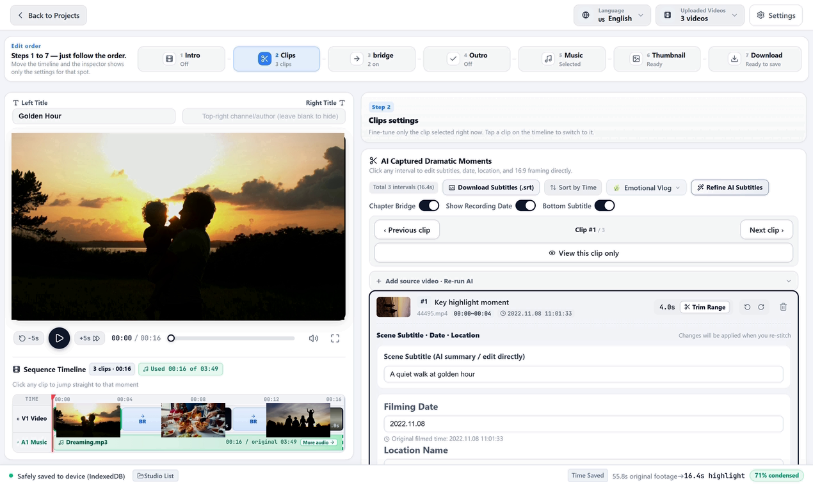

# PenguinCut · 펭귄컷

**Browser-based AI video highlight editor.**  
Find the strongest moments in long footage and turn them into one cinematic **16:9 or 9:16** highlight — captions, music, intro/outro, and chapter bridges included. Original video files stay on your device; only sampled frames are sent for analysis.

[Website](https://penguincut.com/) · [Open Studio](https://penguincut.com/studio) · [한국어](https://penguincut.com/ko/) · [X](https://x.com/penguincut_ai) · [YouTube](https://www.youtube.com/@penguincut_ai)

## What it does

- AI climax detection across clips and long recordings
- Automatic captions refined with context
- Cinematic title, channel, date, and location overlays
- Intro, outro, and chapter bridges for multi-day trips or events
- Royalty-free music with adjustable volume
- **16:9** project for YouTube, **9:16** project for Shorts, Reels, and TikTok
- 7 languages: English, Korean, Japanese, Chinese, Spanish, French, German

## How it works

1. Add your clips in the browser. The original file never leaves your device.
2. Sample frames are scored by a vision model; only those frames and a prompt are sent.
3. Review the proposed cuts, trim or reorder them, then render locally with Canvas, MediaRecorder, and Web Audio.

## Privacy

- Original video files are never uploaded.
- Only sampled frames plus a text prompt are sent for AI analysis.
- Final rendering happens in your browser.
- API keys, when used, are stored in the browser and sent directly to the provider.

## Source code

The app lives in the `reportist-video` package of the Seedtick monorepo:

https://github.com/inpiniti/seedtick/tree/main/reportist-video

## Links

- Website: https://penguincut.com/
- Korean: https://penguincut.com/ko/
- Studio: https://penguincut.com/studio
- X: https://x.com/penguincut_ai
- YouTube: https://www.youtube.com/@penguincut_ai
